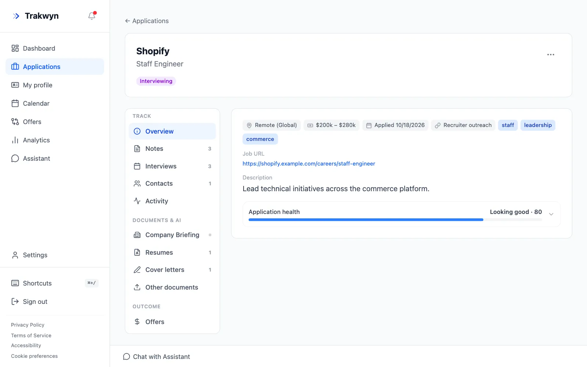
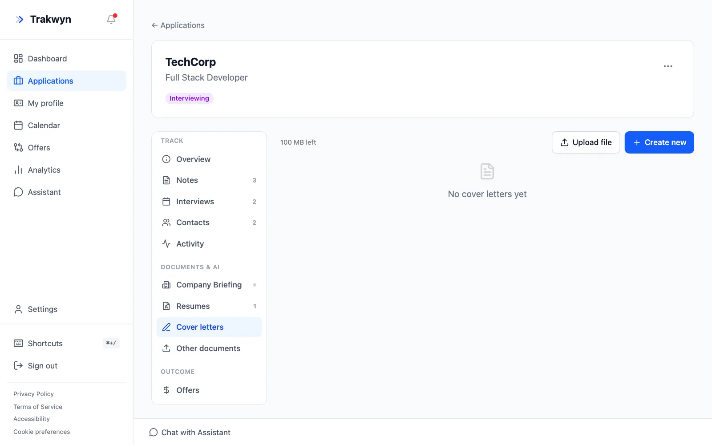
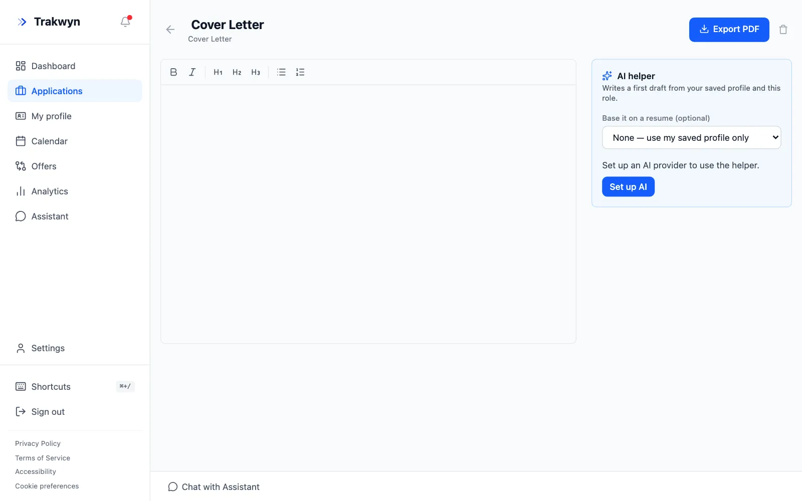

A cover letter that names the role and answers what the posting asks for gets read. This guide shows how to draft one from your saved profile and the job description, then make it yours.

## Before you start

You need two things:

1. **A profile.** Fill in your work experience and skills under **My profile**. The helper writes from it, so it never invents a career you do not have.
2. **An AI provider.** Add your own API key under **Settings** → **AI**, or use Trakwyn AI if your plan includes it.

## 1. Put the job description on the application

Open the application and check the **Description** on the Overview tab. If it is short, edit the application and paste the full posting into **Description / Notes**. The more of the posting you include, the better the letter matches it.

## 2. Create a cover letter

In the application's menu, under **Documents & AI**, choose **Cover letters**. Select **Create new**. The letter belongs to this application, so you will find it here when you need it again.

## 3. Ask the AI helper for a first draft

The editor opens with the **AI helper** beside it. It writes a first draft from your saved profile and this role.

- Optionally choose a **resume** to base it on. Pick the one you tailored for this job so the letter and resume tell the same story.
- Start the draft, then read it.

If the helper says it needs an AI provider, choose **Set up AI** and add a key first.

## 4. Edit it until it sounds like you

The draft is a starting point. Check every claim against your real experience, cut anything generic, and name something specific about the company. The editor supports bold, italics, headings and lists.

## 5. Export it

When you are happy with it, select **Export PDF**. Attach the PDF to your application, then record that you sent it by moving the application to **Applied** on the board.

New to Trakwyn? Start with [Track your first job application](/guides/track-your-first-job-application).
