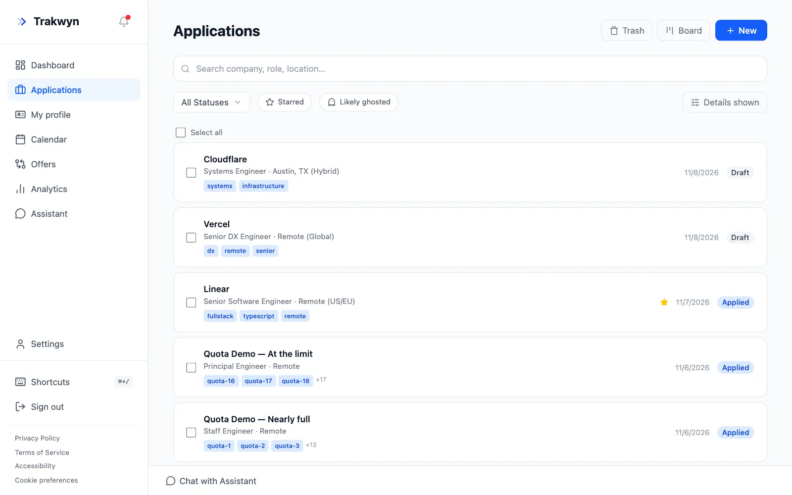
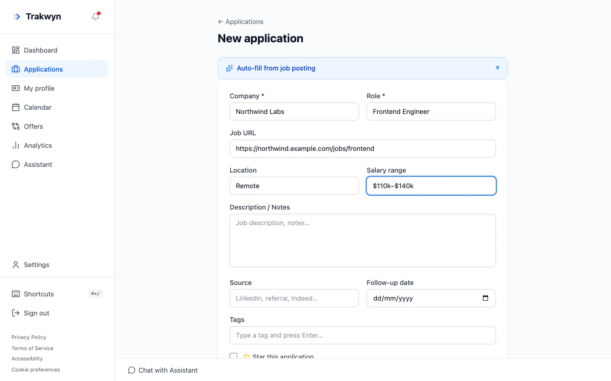
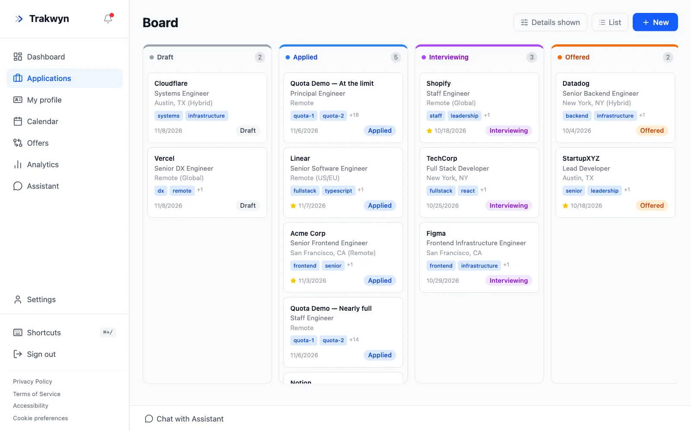
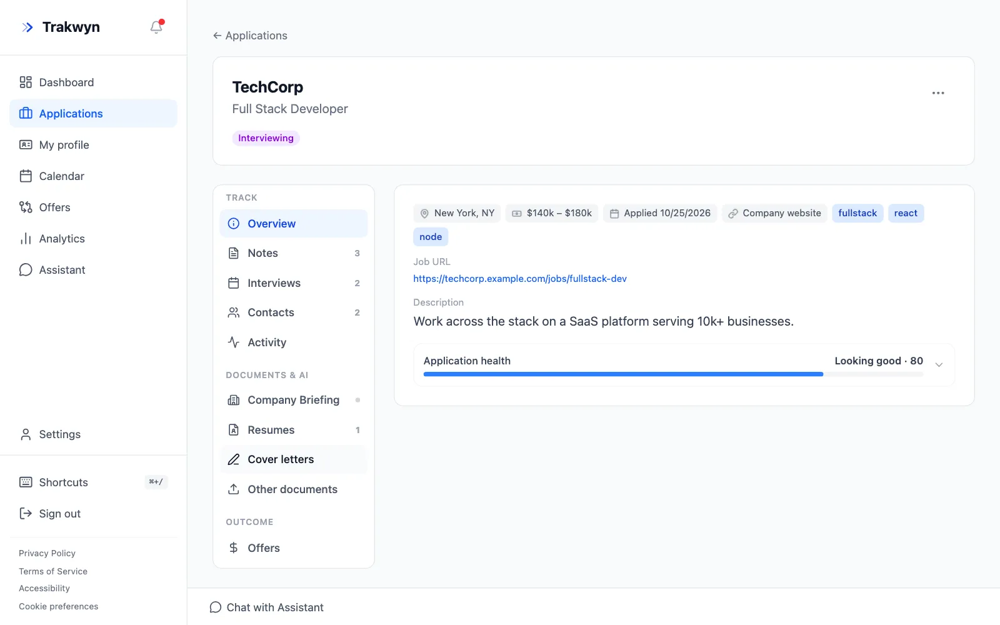

A job search gets messy fast. This guide takes about five minutes and ends with your first application tracked in Trakwyn, so you always know where each one stands.

## 1. Open your applications

Sign in and choose **Applications** in the sidebar. This is the list of everything you have applied to, with the company, role, location, status and tags on each row. Use the search box to find one, or the status filter to see only interviews or offers.

Select **New** to add an application.

## 2. Fill in the basics

Only **Company** and **Role** are required. Everything else helps you later:

- **Job URL**: a link back to the posting, so you can re-read it before an interview.
- **Location** and **Salary range**: handy when you compare offers.
- **Description / Notes**: paste the job description here. It is what Trakwyn's AI tools read when they tailor a resume or cover letter.
- **Source** and **Follow-up date**: where you found the role, and when to chase it.
- **Tags**: free-form labels such as `remote` or `startup`.

Short on time? Open **Auto-fill from job posting** at the top of the form, paste the posting's link, and Trakwyn fills in what it can find. Check the result before you save.

## 3. Move it across the board

Open the **Board** from the Applications page. Each column is a stage: Draft, Applied, Interviewing, Offered and so on. Drag a card to the next column when something changes, and the application's status follows.

A card shows the company, role, tags and the date, and a star marks the ones you care most about.

## 4. Keep everything for one role together

Select an application to open its page. The left menu holds everything about that role:

- **Notes** for what you learned on a call.
- **Interviews** for dates and rounds. They also appear in your calendar.
- **Contacts** for the recruiter and the hiring manager.
- **Activity** for a history of every change.

## What next?

Tracking is the foundation. Once a few applications are in, you can write a tailored cover letter for each one in a couple of minutes: see [Tailor a cover letter to a job posting](/guides/tailor-a-cover-letter-to-a-job-posting).
